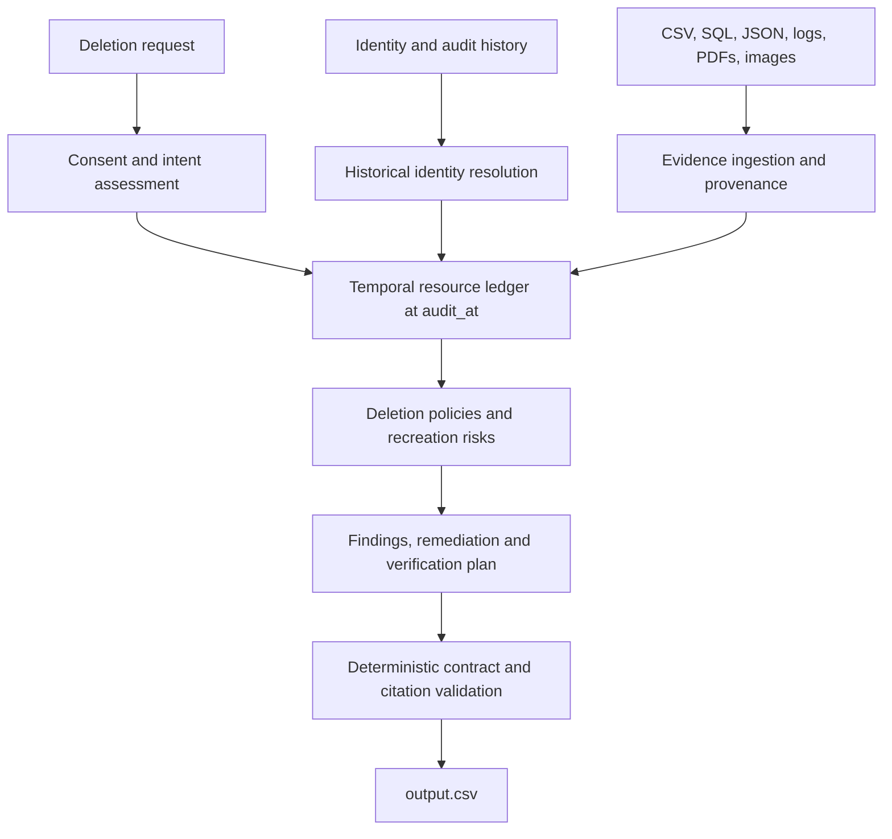

<div align="center">

# GhostGraph

### An evidence-first AI-assisted deletion audit engine

**A deletion workflow can say “Complete” while personal data still exists.** GhostGraph checks the evidence, reconstructs the state of affected records, and produces an auditable deletion assessment and action plan.

[](https://www.python.org/)
[](https://scikit-learn.org/)
[](https://github.com/ABhattacharya-dev/hackerrank-orchestrate-october26/tree/submission-v5.1)
[](#evaluation)
[](#approach-overview)

[**Quick start**](#quick-start) · [**Approach**](#approach-overview) · [**Evaluation**](#evaluation) · [**Project structure**](#project-structure) · [**Challenge**](https://www.hackerrank.com/contests/hackerrank-orchestrate-october26/challenges/ghost-data-still-exists)

*Built for HackerRank Orchestrate October 2026 — Ghost Data Still Exists.*

</div>

---

## What does GhostGraph do?

Deleting a user account does not necessarily remove its copies from databases, analytics systems, support files, logs, backups, or replicas. Imports and restore processes can also bring deleted information back. Some security or legal records, meanwhile, must be retained under policy.

GhostGraph audits each request **as of its own `audit_at` timestamp** and answers:

1. **Is deletion authorized?** Distinguish real instructions from quoted, hypothetical, conditional, or third-party requests.
2. **What does the evidence prove?** Resolve historical identities and record copies; avoid using evidence that was unavailable at the audit cutoff.
3. **What must happen next?** Generate `COMPLETE`, `INCOMPLETE`, or `NOT_APPLICABLE` with ordered, evidence-backed findings, remediation steps, and verification checks.

> [!IMPORTANT]
> **Audit and planning only.** GhostGraph does not delete real data or modify external systems. Its competition predictions are not guarantees of real-world deletion or high-assurance certification.

## Quick start

### Requirements

- **Python 3.12** with virtual environment support.
- **Tesseract OCR**, including English language data, and **Poppler `pdftotext`** on your `PATH`.
- The competition's **participant-facing `dataset/`** directory, placed beside `code/` (the dataset is not included in `code.zip`).
- No paid API key, hosted language model, external model service, or separately downloaded model weights.

### 1. Get the project

```bash
git clone https://github.com/ABhattacharya-dev/hackerrank-orchestrate-october26.git
cd hackerrank-orchestrate-october26
git checkout submission-v5.1
```

Alternatively, extract the released `code.zip` and place the supplied `dataset/` next to the extracted `code/` directory. Skip the Git commands when using the ZIP.

### 2. Install system tools and Python dependencies

<details open>
<summary><strong>Ubuntu / Debian</strong></summary>

```bash
sudo apt-get update
sudo apt-get install -y poppler-utils tesseract-ocr
python3.12 -m venv .venv
source .venv/bin/activate
python -m pip install -r code/requirements.txt
```

Python 3.12 must already be installed; the commands above install OCR utilities and the pinned Python dependencies.

</details>

<details>
<summary><strong>macOS</strong></summary>

```bash
brew install poppler tesseract
python3.12 -m venv .venv
source .venv/bin/activate
python -m pip install -r code/requirements.txt
```

Requires Homebrew and Python 3.12.

</details>

<details>
<summary><strong>Windows PowerShell</strong></summary>

Install Python 3.12, [Tesseract OCR](https://github.com/tesseract-ocr/tesseract) and [Poppler](https://poppler.freedesktop.org/) first. Make sure `tesseract` and `pdftotext` can be run from PowerShell.

```powershell
py -3.12 -m venv .venv
.\.venv\Scripts\python.exe -m pip install -r code/requirements.txt
```

There is no need to change PowerShell's script execution policy or activate the environment when using its Python executable directly.

</details>

### 3. Generate predictions

**Linux / macOS** (after activating the environment):

```bash
python code/main.py --mode predict
```

**Windows PowerShell:**

```powershell
.\.venv\Scripts\python.exe code/main.py --mode predict
```

The command reads `dataset/deletion_requests.csv` and writes a validated **`output.csv` in the project root**. The released run produces one row for each of the **518 supplied requests**.

You can override the input and destination using `--requests PATH` and `--output PATH`. Run the command from the project root for the simplest setup; the CLI resolves its default dataset path relative to the project files.

## Approach overview

GhostGraph uses a **hybrid design**: selective local machine learning for request intent, with deterministic code for evidence handling, policy reasoning, planning, and output validation.



| Stage | Implementation approach |
| --- | --- |
| **Authorization** | A consent/speech-act layer handles clear scope, quotation, negation and conditions; a local word/character TF-IDF logistic-regression classifier handles selected ambiguous or multilingual intent cases. |
| **Evidence ingestion** | Read-only adapters process CSV, SQL, JSON, text/logs, PDFs and images; observations retain source IDs, timestamps, scopes and provenance. SQL snapshots are parsed using isolated SQLite. |
| **Identity resolution** | Current and historical identifiers are linked through supported evidence, not shared names, coincidental IDs or unsupported time proximity. |
| **Temporal reconstruction** | Each request is evaluated independently at `audit_at`, accounting for capture availability, replicas, contradictions and historical changes. A worker's “success” report is not automatically proof of absence. |
| **Policy and risk analysis** | Rules from `deletion_rules.csv` determine DELETE, REDACT, ANONYMIZE and RETAIN obligations. Active sync/import/restore paths are considered for potential re-creation. |
| **Planning and validation** | Deterministic code generates the mandated phases, operation order, step numbers, allowed states and evidence citations. No unconstrained LLM writes the final JSON. |

**Why this design?** It keeps the learned component focused on a task where language interpretation helps, while making deletion-related decisions inspectable, reproducible, and tied to the supplied evidence. It needs no graph database or hosted inference service.

Key source modules: [`authorization.py`](code/ghostgraph/authorization.py), [`intent.py`](code/ghostgraph/intent.py), [`evidence.py`](code/ghostgraph/evidence.py), [`identity.py`](code/ghostgraph/identity.py), [`temporal.py`](code/ghostgraph/temporal.py), [`policy.py`](code/ghostgraph/policy.py), [`prediction.py`](code/ghostgraph/prediction.py) and [`contract.py`](code/ghostgraph/contract.py). More detail is in [`code/ARCHITECTURE.md`](code/ARCHITECTURE.md).

## Output contract

```csv
case_id,deletion_status,steps_json
```

| Status | Interpretation |
| --- | --- |
| `COMPLETE` | Evidence supports the required end state; verification steps document the checks. |
| `INCOMPLETE` | Supported findings indicate outstanding work or a re-creation risk, with proposed remediation and verification. |
| `NOT_APPLICABLE` | The request does not currently authorize deletion; the step array is `[]`. |

`steps_json` is an ordered JSON array. Actual findings and completed checks cite eligible evidence; planned future remediation and verification use empty evidence IDs. See [`problem_statement.md`](problem_statement.md) for the complete enum, policy, and ordering requirements.

## Evaluation

**Frozen production release:** [`submission-v5.1`](https://github.com/ABhattacharya-dev/hackerrank-orchestrate-october26/tree/submission-v5.1) (`7a18c2e`).

| Verified measurement | Result |
| --- | ---: |
| Full prediction rows | **518 / 518** |
| Structural violations in submitted full output | **0** |
| Software tests | **156 passed** |
| Public reference exact rows | **9 / 32** |
| Correct public deletion statuses | **29 / 32** |
| Matching public canonical steps | **159 / 193** |
| Public step precision / recall / F1 | **97.55% / 82.38% / 89.33%** |
| Local learned inference calls (full run) | **5** |
| Hosted model calls / API charges | **0 / $0** |

These are public-reference metrics and full-file validation results, **not hidden-test results**. Local CPU/OCR costs were not priced. The authorization improvements in V5.1 did **not** change the frozen CSV predictions.

### Tests and evaluation reports

On Linux / macOS, after activating the environment:

```bash
PYTHONPATH=code python -m unittest discover -s code/tests -v
PYTHONPATH=code python -m research.v5_final_evaluate
```

The second command uses public references for evaluation and writes research output under `.ghostgraph/v5/`; it does not overwrite the released `output.csv`. Public answer labels are not used as prediction inputs. Windows users can set `$env:PYTHONPATH = 'code'` and run these modules through `.\.venv\Scripts\python.exe`.

Read the actual [evaluation report](code/evaluation/evaluation_report.md), [model usage report](code/evaluation/usage_report.md), and [release checks](code/evaluation/release_report.md) for test scenarios, validation, costs, and remaining mismatches.

<details>
<summary><strong>Strict certification and uncertainty</strong></summary>

```bash
python code/main.py --mode certify --output output.certified.csv
```

This separate, more conservative mode does **not** produce a certified file on the supplied full dataset: it exits with code `2` because **490 cases have unresolved proof obligations**. This does not mean 490 predictions are missing from `output.csv`.

Requests with unmet consent conditions, uncertain present consent or unsupported third-party authority are not treated as presently authorized. An otherwise authorized request with unproven resource ownership remains an evidence question; the system does not invent links. Irreducibly uncertain intent can block export rather than silently guessing. The tool never executes real deletions.

</details>

## Project structure

```text
.
├── README.md                      # Setup and approach overview
├── problem_statement.md          # Official challenge specification
├── AGENTS.md                     # Agent engineering/logging instructions
├── code/
│   ├── main.py                   # CLI entry point
│   ├── requirements.txt          # Pinned Python dependencies
│   ├── ghostgraph/               # Authorization, evidence and audit engine
│   ├── evaluation/               # Validators and measured reports
│   ├── tests/                    # Unit and adversarial regressions
│   └── research/                 # Retained experiments and reports
├── dataset/                      # Supplied separately; excluded from code.zip
├── output.csv                     # Submission predictions
└── log.txt                        # Separate authentic chat transcript
```

### Submission artifacts

HackerRank requires `code.zip` (source with README and evaluation reports), `output.csv` (predictions), and the authentic root `log.txt` as the chat transcript. The participant dataset, credentials, virtual environments, generated caches and nested ZIPs must not be packaged.

To create the source archive, run from the repository root:

```bash
python code/package.py --output code.zip
```

**Note:** Changing this README and rebuilding `code.zip` creates a *new* archive with a new hash. The previously verified V5.1 submission archive remains unchanged unless separately rebuilt and revalidated.

## Known limitations

- The system does not claim full high-assurance deletion certification, perfect public-reference accuracy, or hidden-evaluation performance.
- Some historical ownership relationships and source observations remain unsupported or ambiguous; guesses are not substituted for evidence.
- The local classifier is bounded by its training examples and test coverage; not every language or consent construction is guaranteed to work.
- Original coding-agent model metadata was not available in the historical development transcript and was not invented. This is separate from the application model documented above.

---

<div align="center">

**GhostGraph** · Evidence before assumptions · Planning before irreversible action

[Back to top](#ghostgraph) · [HackerRank challenge](https://www.hackerrank.com/contests/hackerrank-orchestrate-october26/challenges/ghost-data-still-exists)

</div>
